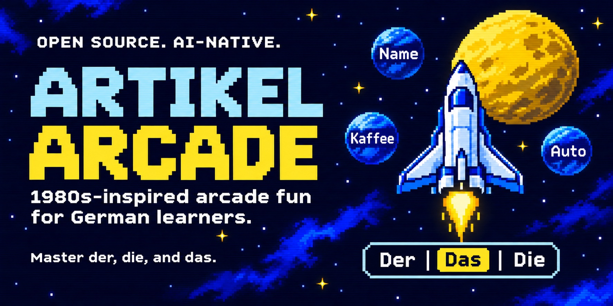

# Artikel Arcade

An open-source, AI-native German learning game inspired by 1980s arcades. Practice der, die, and das while a shuttle travels through a pixel-art universe.



The vocabulary comes from German learning materials, including supplied Starten Wir! lesson lists. The application uses Next.js, React, and TypeScript, with progress stored locally in the browser.

## Play

Choose a level and lesson in Mission control. Each word planet approaches the shuttle, and the game checks the selected article as the planet passes it.

- **← / →** selects Der, Das, or Die beneath the shuttle.
- **↑ / ↓** adjusts flight speed from 0.5× to 3×.
- **Esc** opens the game menu and pauses the flight.
- **Pause / Resume** controls the flight directly.
- **Main page** returns to Mission control.

Correct answers award 100 points and show green feedback. Incorrect answers show red feedback and reveal the correct article. The word radar follows the current word and supports manual scrolling. Touch controls are available on smaller screens and touch devices.

The game menu provides access to Mission control, Word collection, Flight log, Settings, and the GitHub repository. Word collection supports level and lesson filters, search, vocabulary browsing, and article practice.

## Run locally

Use Node.js 22 or later and npm.

```sh
git clone https://github.com/Rezarezaeipour/German-game.git
cd German-game
npm ci
npm run dev
```

Open http://localhost:3000. For a production build, stop the development server and run the following commands sequentially.

```sh
npx tsc --noEmit
npm run build
```

The application requires a server-enabled Next.js deployment. Preview the production build locally with the following command.

```sh
npm start
```

Phone controllers require `ABLY_API_KEY` in `.env.local` during development and in the hosting environment for production. Follow the setup and learning guide. [Phone controller guide](docs/phone-controller.md) · [Controller contributor reference](docs/controller-contributing.md)

## Technologies

- Next.js 15 with App Router and server-side pairing routes.
- React 19 and TypeScript for the interface and game state.
- CSS for the blue-and-yellow arcade design, pixel planets, starfield, and animation.
- Lucide React for interface icons.
- Browser APIs for animation, optional sound effects, and localStorage persistence.

## Phone controller

During a flight, select Connect phone and scan the QR code. The phone displays large arrow buttons across two rows. Pairing is anonymous and expires after 30 minutes. A disconnected controller pauses the game. Ably carries realtime commands, and the server issues restricted permissions. Game progress stays in localStorage.

## Vocabulary and levels

Each level from A1 to C2 has 12 episode slots, with one episode per lesson.

- **A1** has all 12 lessons populated from supplied vocabulary photos, with 1,076 entries and 534 entries with printed articles.
- **A2–C2** each have five illustrative sample words in Lesson 1. Further lesson lists can be contributed.
- A separate eight-word demo is also available.

Browse words includes nouns, verbs, phrases, numbers, and other lesson vocabulary. The game and article practice use entries with articles. Entries preserve printed forms and plurals, with English meanings added for practice. Counts reflect lesson entries, including words repeated in different lessons.

Progress is saved on the current browser and device. Settings provides a progress reset. The project is inspired by the Leitner system, and spaced-repetition scheduling remains planned work.

## Project structure

```text
app/
  page.tsx                   Game, menus, scoring, and persistence
  layout.tsx                 Root layout and metadata
  globals.css                Responsive arcade styling
  components/
    WordCollection.tsx       Vocabulary browsing and article practice
  data/
    curriculum.ts            Levels, lesson registration, and vocabulary types
    vocabulary-builders.ts   Helpers for words and categories
    a1-lesson-*.ts            A1 lesson vocabulary
public/                      Static images and social preview
```

## Contribute

Contribute vocabulary, translations, accessibility improvements, gameplay changes, documentation, or bug fixes. The contributor guide covers setup, lesson registration, verification, and pull requests. Coding agents can read the repository instructions and use the task prompt provided in the guide. [Contributor guide](CONTRIBUTING.md) · [Agent instructions](AGENTS.md)

## Authors and contributors

- Reza Rezaeipour — author and maintainer.

Contributors are welcome through GitHub issues and pull requests. [Repository](https://github.com/Rezarezaeipour/German-game) · [Creator website](https://rezarezaeipour.com)

## License status

License selection is pending. This checkout currently has no `LICENSE` file.
